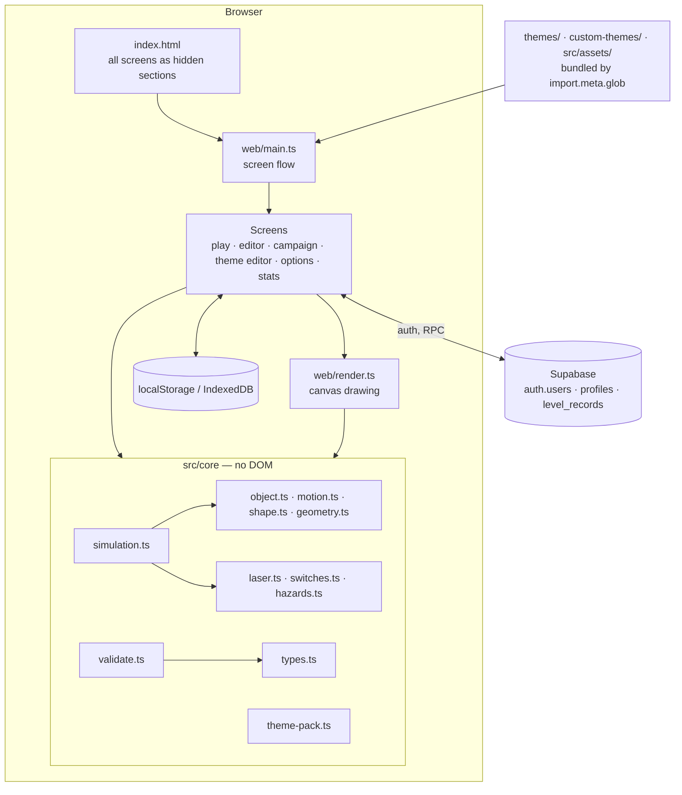
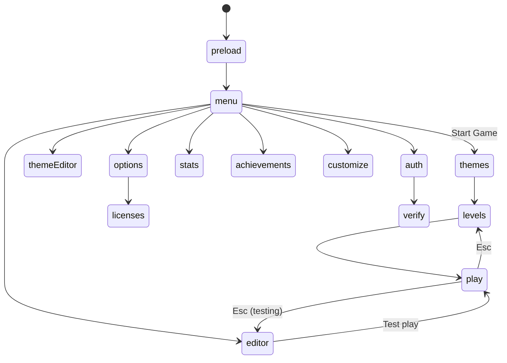
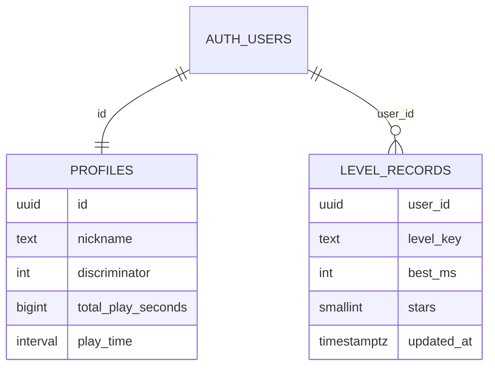

# Architecture

Avoid N Survive Maker is a static, single-page web game (TypeScript + Vite, no UI framework).
It has two code layers, content folders read at build time, and an optional Supabase backend for
accounts.

## 1. Layers

| Layer | Folder | Rule |
|---|---|---|
| Core | `src/core/` | Pure TypeScript, **no DOM**. Map schema, geometry, simulation, validation, theme pack format. Can run in Node (tests) or later on a server to verify replays. |
| Web | `src/web/` | Everything that touches the DOM, canvas, audio, storage or network. Imports core, never the other way. |
| Content | `themes/`, `custom-themes/`, `src/assets/` | JSON levels, theme packs, fonts and music, bundled at build time by Vite. |
| Backend | `supabase/migrations/` | SQL only: tables, row level security and `security definer` RPCs. No server code of our own. |

`src/core/index.ts` re-exports the core API. Unit tests live next to the code (`*.test.ts`, Vitest).

## 2. Core (`src/core`)

### Map model
- **`types.ts`**: `MapData` (format v2). A map has a size, START and GOAL rectangles, and a list of
  `MapObject`s. Each object is **shape × role × behaviour**:
  - shape: rect, circle, polygon or freeform (`shape.ts` turns every shape into one closed polygon,
    used for both drawing and collision)
  - role: `path`, `wall`, `coin`, `dark`, `trigger` (switch), `door`, `laser`, `mirror`, `portal`, `text`, `safe`
  - behaviour: route motion and rotation (`motion.ts`), spikes, saws and boulders (`hazards.ts`),
    switch links (`switches.ts`)
- Optional per-map look (`theme`: wall and path fills), star times, darkness, level number and title.
- **`validate.ts`**: the only way external JSON becomes a `MapData`. It checks every field and migrates the v1 format.
- **`share.ts`**: map ⇄ URL code (deflate-raw + base64url) for share links (`#m=…`).

### Simulation (`simulation.ts`)
- Deterministic, **fixed 1 ms tick**. The cursor path between input samples is treated as line
  segments, split at every millisecond.
- `object.ts` compiles each object once (`compileMap`). Its pose at time *t* is closed-form:
  `world = R(θ)·(local − pivot) + pivot + d`. Collision tests run in each object's local frame, so a
  moving obstacle becomes a static polygon and nothing can be skipped over.
- Safe = inside a path (or the map has no paths) **and** inside no wall. Coins, switches, doors,
  lasers (`laser.ts`) and portals are all part of the same tick.
- The same samples always give the same result, so a `Replay` can be re-run (`runReplay`) to verify a clear.

### Other core modules
| File | Purpose |
|---|---|
| `level.ts` | Stars for a clear time, star-goal text |
| `theme-pack.ts` | Theme pack format (`theme.json`): info, colors, badge style, maze colors, music, custom screens; `themedLevel()` applies a theme to a level |
| `screen-layout.ts` | Layout schema for custom level-select screens (a 1280×720 stage of elements) |
| `arrange.ts`, `merge.ts` | Editor operations: align, flip, z-order; merge shapes (polygon-clipping) |
| `account.ts` | Nickname, email and password rules (mirrored by the database), `Name#0042`, play time format |
| `time.ts` | All displayed timestamps are UTC (`formatUtc`) |
| `font-catalog.ts`, `colors.ts`, `theme.ts` | Bundled font list and licenses, the 16 switch colors, map theme presets |

## 3. Web (`src/web`)

### Screen flow (`main.ts`)
All screens are sections in `index.html`. `main.ts` owns a single `current: Screen` and switches
with `show(next)`. That runs an iris transition (`iris-transition.ts`), then `showImmediately`, which
hides the other screens and calls the hooks for the new one: render, focus, music, background.

| Screen | Module | Notes |
|---|---|---|
| preload | `preload.ts` | Loads fonts, account session and shared map, with a progress bar and timeout |
| menu | `index.html` + `main.ts` | 45°-rotated tile grid (`fitRotatedGrid`), 3D layered logo (CSS) |
| themes / levels | `campaign-ui.ts`, `screen-render.ts` | World and level select; themes can ship a custom level-select layout |
| play | `play.ts` | Canvas game loop; HUD panel hidden, keyboard shortcuts R / N / F / Esc |
| editor | `editor.ts`, `theme-panel.ts`, `float-panel.ts`, `context-menu.ts` | Map editor, theme presets (incl. chapter themes) |
| themeEditor | `theme-editor.ts`, `screen-designer.ts`, `theme-zip.ts` | Theme packs: colors, badge, cover, music, levels, custom screens; zip import/export |
| options / licenses | `options.ts`, `menu-music.ts`, `font-licenses.ts` | Volumes, trail, timer, debug panel, menu music override, record sync |
| stats | `stats-ui.ts` | Reads the profile and `level_records` straight from the database |
| auth / verify | `auth/auth-ui.ts` | Sign-up, sign-in, email verification |

### Play loop (`play.ts` + `input.ts`)
1. `input.ts` collects every pointer sample (`pointerrawupdate` + `getCoalescedEvents`, ~1 ms at 1000 Hz).
2. Clicking inside START creates a `Simulation` and starts the run. Each sample is `feed()`-ed with its event timestamp.
3. Each animation frame calls `advanceTo(now − margin)`, so time keeps passing while the mouse is idle.
4. `render.ts` draws the map at `sim.time` with the simulation's state: hidden objects, switch
   clocks, door openness, beams, coins left. A locked GOAL is dark gray and shows `collected/total`.
5. When the run is cleared, `onClear(map, replay, time)` goes to `main.ts`, which records progress
   and marks editor maps as verified for sharing.

### Rendering (`render.ts`, `badge.ts`, `theme-pattern.ts`)
- One 16:9 canvas per screen, letterboxed by `fitCanvas` and `beginFrame`.
- Static walls and floor are pre-rendered into a cached layer per scale and theme. Only moving
  objects are redrawn each frame.
- `badge.ts` draws the level number and title badge at the top-left in the theme's design. Editor
  maps that use a chapter preset get that chapter's badge.

### Themes and content (`theme-registry.ts`)
- `import.meta.glob` bundles every `themes/*/theme.json`, its levels and its assets (images, fonts, music) at build time.
- `CHAPTER_FOLDERS` fixes the 16 official chapters in order (21 level slots each). `custom-themes/` holds presets for the theme editor.
- One player-made custom pack can be loaded from a zip and is stored in localStorage.
- `chapterForTheme(map.theme)` finds the chapter whose maze colors exactly match a map's. That
  choice decides editor music and badge design.

### Background and audio
- **`backdrop.ts`**: one fixed layer behind all screens. Its `data-mode` is set per screen:
  - `demo`: main menu and most screens
  - `grid`: world select, map editor, theme editor
  - `theme`: level select, in the theme's colors
  - `none`: play
- **`demo-pilot.ts`**: the main menu demo. It plans a cursor route with space-time A* on a coarse
  grid, in time slices so frames never stall. The real `Simulation` then plays the route.
- **`audio.ts`**: Web Audio graph `track fade → music gain → master gain`, plus an effects gain. Music
  crossfades on change (0.9 s out, 1.2 s in). The last two decoded tracks are cached.
  - Menu screens play the menu music.
  - Level select and play use the theme's own music.
  - The map editor plays its chapter preset's music, or the menu music.

## 4. State and persistence

| Data | Where | Module |
|---|---|---|
| Options (volumes, trail, timer…) | localStorage | `options.ts` |
| Menu music override | IndexedDB (Blob) | `menu-music.ts` |
| Campaign progress (best ms, stars) per level key | localStorage `avoid-n-survive:progress` | `progress.ts` |
| Editor draft + verification | localStorage | `editor.ts` |
| Custom theme pack | localStorage (data URLs) | `theme-registry.ts` |
| Unsent play time / records per account | localStorage, retried later | `auth/playtime.ts`, `auth/records.ts` |
| Account, play time, level records | Supabase | `auth/*` |

Level keys: `<theme id>/<index>` for chapters, `custom:<theme id>/<index>` for custom packs.

## 5. Backend (Supabase)

- **Sign-up**: email + password + nickname, protected by a Turnstile CAPTCHA (`auth/captcha.ts`).
  The email is verified with PKCE (`?code=`), so the URL hash stays free for share links. A database
  trigger assigns a random, unique `#tag` for the nickname.
- **Play time**: `add_play_time(seconds)` every 30 s while the tab is visible. The server caps each
  report to the real elapsed time, so several tabs can't double count.
- **Level records**:
  - Every clear goes up with `submit_level_records(jsonb)`.
  - The server merges, keeping the lowest `best_ms` and the highest `stars`.
  - **Options → Sync records** uploads all local records and downloads the account's records.
  - Row level security: players read only their own rows.
- Clients never write tables directly. Every write is a `security definer` function that checks `auth.uid()`.
- Without `.env.local` (no Supabase keys) the game runs fully offline. Account features are simply unavailable.

## 6. Build and tooling

- `npm run dev`: Vite dev server (or `run-dev.bat` on Windows).
- `npm run build`: `tsc --noEmit` + `vite build`. The output in `dist/` is a static site, served with `base: './'` so it works from a sub-path.
- `npm test`: Vitest unit tests for core logic and theme pack loading.
- `VERSION` holds the displayed version (`Update N`).
- `scripts/make-chapter-themes.ps1` rebuilds the planned chapters' artwork and theme packs (chapters 2–16).

## 7. Design principles

- **Determinism first**: gameplay depends only on input samples and map data, never on frame rate,
  so clears can be replayed and verified.
- **Core stays DOM-free**, so the same rules can run on a server.
- **Validate at the boundary**: every map, theme or pack from outside goes through `validate*` before use.
- **Content is data**: chapters, levels, badges, screens and music are JSON and asset files, not code.
- **Offline-capable**: accounts are an optional layer on top of local progress.
- **Writes only through server functions**: the database rules (caps, merges, uniqueness) are
  enforced in SQL, not trusted to the client.
