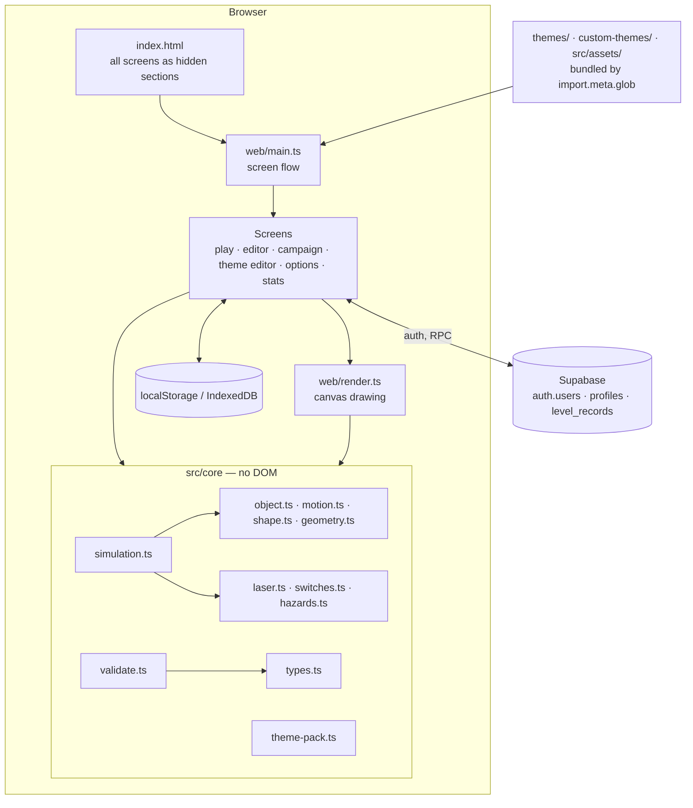
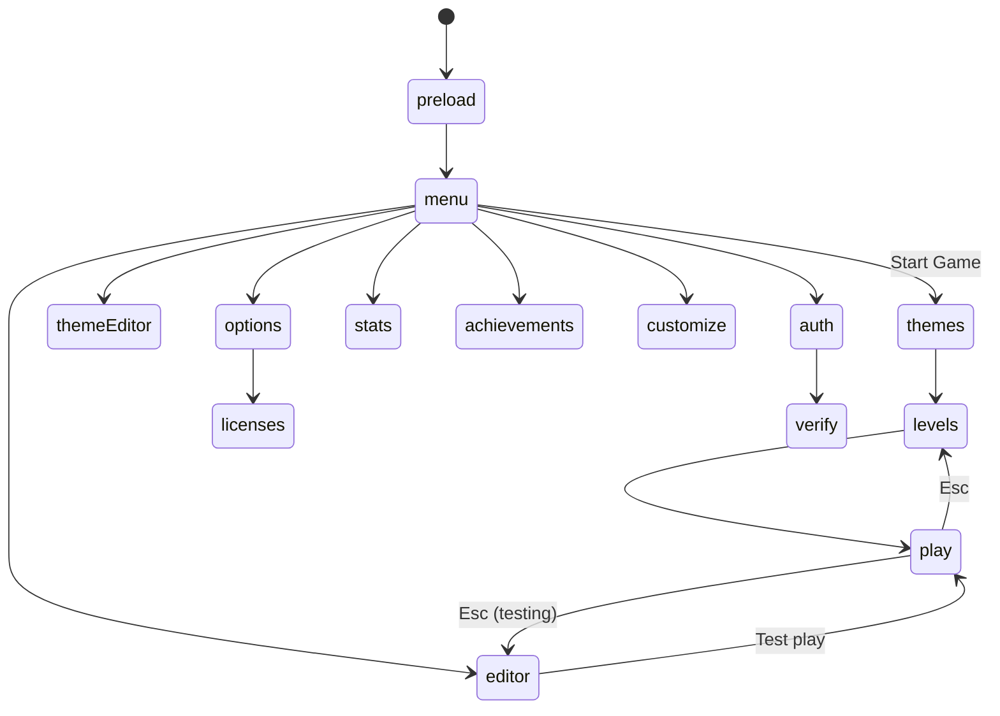
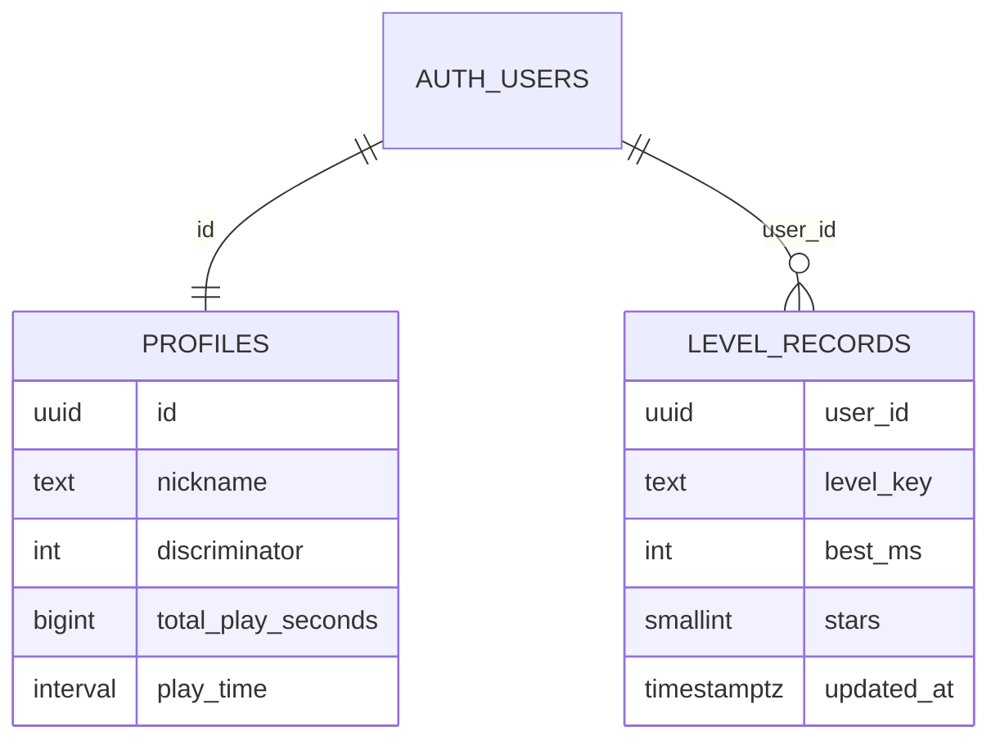

# 아키텍처

Avoid N Survive Maker 는 정적인 단일 페이지 웹 게임입니다(TypeScript + Vite, UI 프레임워크 없음).
브라우저 UI와 공용 게임 코어, 빌드 시 읽어 들이는 콘텐츠 폴더, 계정 및 순위 검증을 위한 선택적 Supabase 백엔드로 이루어져 있습니다.

## 1. 계층

| 계층 | 폴더 | 규칙 |
|---|---|---|
| Core | `src/core/` | 순수 TypeScript, **DOM 없음**. 맵 스키마, 기하, 시뮬레이션, 검증, 테마 팩 형식. Node(테스트)에서 실행할 수 있습니다. |
| Web | `src/web/` | DOM, 캔버스, 오디오, 저장소, 네트워크를 다루는 모든 코드. core 를 import 하며, 반대 방향은 없습니다. |
| Content | `themes/`, `custom-themes/`, `src/assets/` | JSON 레벨, 테마 팩, 폰트, 음악. 빌드 시 Vite 가 번들합니다. |
| Backend | `supabase/migrations/` | SQL 권한과 RPC. 기록·사망·플레이 시간·도전과제를 계정에 저장합니다. |

`src/core/index.ts` 가 core API 를 다시 내보냅니다. 단위 테스트는 코드 옆에 있습니다(`*.test.ts`, Vitest).

편집 상태·명령·저장·속성 패널 및 번역기 주입의 경계는 [EDITOR_ARCHITECTURE.md](EDITOR_ARCHITECTURE.md)를 참고하세요.

## 2. Core (`src/core`)

### 맵 모델
- **`types.ts`**: `MapData`(형식 v2). 맵은 크기, START 와 GOAL 사각형, `MapObject` 목록을 가집니다. 각 오브젝트는 **모양 × 역할 × 동작** 입니다.
  - 모양: rect, circle, polygon, freeform (`shape.ts` 가 모든 모양을 하나의 닫힌 다각형으로 바꾸며, 그리기와 충돌에 함께 사용)
  - 역할: `path`, `wall`, `coin`, `dark`, `trigger`(스위치), `door`, `laser`, `mirror`, `portal`, `text`, `safe`
  - 동작: 경로 이동과 회전(`motion.ts`), 가시·톱날·바위(`hazards.ts`), 스위치 연결(`switches.ts`)
- 맵별 선택 항목: 모양(`theme`: 벽과 길 채우기), 별 기준 시간, 어둠, 레벨 번호와 제목.
- **`validate.ts`**: 외부 JSON 이 `MapData` 가 되는 유일한 통로입니다. 모든 필드를 검사하고 v1 형식을 변환합니다.
- **`share.ts`**: 공유 링크(`#m=…`)를 위한 맵 ⇄ URL 코드(deflate-raw + base64url).

### 시뮬레이션 (`simulation.ts`)
- 기본값은 결정론적인 **1 ms 틱**입니다. 입력 샘플 사이의 커서 경로를 선분으로 봅니다. 그래픽 설정의 `시뮬레이션 절약`을 켜면 다음 플레이부터 가능한 구간은 최대 8 ms 간격으로 나누고, 골인·충돌 시점은 선분의 교차 비율로 보간하여 기록의 1 ms 단위를 유지합니다. 입력 샘플 자체는 이 옵션으로 생략하지 않습니다.
- 이동·회전·낙하·점멸 장치가 있어도, 커서 이동 구간이 관련 장치의 전체 동작 범위(`interactionBounds`) 밖이면 8 ms까지 묶습니다. 동작 범위와 겹치거나 동전·크리스탈을 획득할 수 있는 구간은 1 ms로 검사합니다. 회전은 두 시점의 위치만 비교하지 않고 전체 회전 반경을 포함하며, 점멸로 숨겨진 장치도 검사 대상에 남깁니다.
- 얼음, 스위치 연결, 트리거, 문, 포탈, 도르래, 레이저, 포탑이 있는 맵은 적분 및 상태 갱신 순서를 보존하기 위해 기존 1 ms 계산을 유지합니다. 따라서 성능 개선 폭은 맵과 입력 샘플 간격에 따라 달라집니다.
- `object.ts` 가 각 오브젝트를 한 번 컴파일합니다(`compileMap`). 시간 *t* 에서의 자세는 닫힌 식입니다:
  `world = R(θ)·(local − pivot) + pivot + d`. 충돌 검사는 각 오브젝트의 로컬 좌표계에서 하므로, 움직이는 장애물이 정지한 다각형이 되어 어떤 것도 건너뛸 수 없습니다.
- 안전 = 길 안(또는 맵에 길이 없음) **이고** 어떤 벽 안에도 없음. 코인, 스위치, 문, 레이저(`laser.ts`), 포털 모두 같은 틱에서 처리됩니다.
- 같은 샘플과 계산 모드는 같은 결과를 내므로, `Replay`를 다시 실행(`runReplay`)해 클리어를 검증할 수 있습니다. 8 ms 모드의 리플레이는 `simulationStepMs: 8`을 저장하며, 이 필드가 없는 기존 리플레이는 1 ms로 재생합니다.

### 기타 core 모듈
| 파일 | 용도 |
|---|---|
| `level.ts` | 클리어 시간에 따른 별, 별 목표 문구 |
| `theme-pack.ts` | 테마 팩 형식(`theme.json`): 정보, 색상, 배지 스타일, 미로 색상, 음악, 커스텀 화면. `themedLevel()` 이 레벨에 테마를 적용 |
| `screen-layout.ts` | 커스텀 레벨 선택 화면의 레이아웃 스키마 (1280×720 스테이지의 요소들) |
| `arrange.ts`, `merge.ts` | 에디터 작업: 정렬, 뒤집기, z-순서, 모양 합치기(polygon-clipping) |
| `account.ts` | 닉네임, 이메일, 비밀번호 규칙(데이터베이스와 동일), `Name#0042`, 플레이 시간 형식 |
| `time.ts` | 표시되는 모든 시각은 UTC (`formatUtc`) |
| `font-catalog.ts`, `colors.ts`, `theme.ts` | 번들 폰트 목록과 라이선스, 스위치 색상 16가지, 맵 테마 프리셋 |

## 3. Web (`src/web`)

### 화면 흐름 (`main.ts`)
모든 화면은 `index.html` 의 섹션입니다. `main.ts` 가 하나의 `current: Screen` 을 갖고 `show(next)` 로 전환합니다. 이 함수는 아이리스 전환(`iris-transition.ts`)을 실행한 뒤 `showImmediately` 를 호출하여, 다른 화면을 숨기고 새 화면의 훅(렌더, 포커스, 음악, 배경)을 실행합니다.

| 화면 | 모듈 | 비고 |
|---|---|---|
| preload | `preload.ts` | 폰트, 계정 세션, 공유 맵을 진행률 표시와 타임아웃과 함께 불러옴 |
| menu | `index.html` + `main.ts` | 45° 회전한 타일 그리드(`fitRotatedGrid`), 3D 레이어 로고(CSS) |
| themes / levels | `campaign-ui.ts`, `screen-render.ts` | 월드와 레벨 선택. 테마가 커스텀 레벨 선택 레이아웃을 가질 수 있음 |
| play | `play.ts` | 캔버스 게임 루프. HUD 패널 숨김, 단축키 R / N / F / Esc |
| editor | `editor.ts`, `editor-properties.ts`, `editor-storage.ts`, `editor-shared.ts` | 입력·캔버스 조정, 속성 패널, 브라우저 저장, 표시 정의를 분리. 편집 상태·명령·히스토리는 `core/editor-document.ts`, `core/editor-commands.ts` |
| themeEditor | `theme-editor.ts`, `screen-designer.ts`, `theme-zip.ts` | 테마 팩: 색상, 배지, 표지, 음악, 레벨, 커스텀 화면, zip 가져오기/내보내기 |
| options / licenses | `options.ts`, `menu-music.ts`, `font-licenses.ts` | 볼륨, 잔상, 타이머, 디버그 패널, 메뉴 음악 교체, 기록 동기화 |
| stats | `stats-ui.ts` | 프로필과 `level_records` 를 데이터베이스에서 직접 읽음 |
| auth / verify | `auth/auth-ui.ts` | 가입, 로그인, 이메일 인증 |

### 플레이 루프 (`play.ts` + `input.ts`)
1. `input.ts` 가 모든 포인터 샘플을 모읍니다(`pointermove` + `getCoalescedEvents`, 1000 Hz 에서 약 1 ms).
2. START 안을 클릭하면 `Simulation` 을 만들고 도전을 시작합니다. 각 샘플은 이벤트 타임스탬프와 함께 `feed()` 됩니다.
3. 애니메이션 프레임마다 `advanceTo(now − margin)` 을 호출하므로, 마우스가 멈춰 있어도 시간이 흐릅니다.
4. `render.ts` 가 `sim.time` 시점의 맵을 시뮬레이션 상태(숨겨진 오브젝트, 스위치 시계, 문 열림 정도, 빔, 남은 코인)와 함께 그립니다. 잠긴 GOAL 은 짙은 회색이며 `collected/total` 을 표시합니다.
5. 클리어하면 `onClear(map, replay, time)` 이 `main.ts` 로 전달되어, 진행 상황을 기록하고 에디터 맵을 공유 가능(검증됨)으로 표시합니다.

### 렌더링 (`render.ts`, `badge.ts`, `theme-pattern.ts`)
- 화면마다 16:9 캔버스 하나를 쓰며, `fitCanvas` 와 `beginFrame` 이 레터박스를 처리합니다.
- 고정된 벽과 바닥은 배율과 테마별로 캐시된 레이어에 미리 그립니다. 움직이는 오브젝트만 매 프레임 다시 그립니다.
- `badge.ts` 는 왼쪽 위에 테마 디자인으로 레벨 번호와 제목 배지를 그립니다. 챕터 프리셋을 쓰는 에디터 맵은 그 챕터의 배지를 받습니다.

### 테마와 콘텐츠 (`theme-registry.ts`)
- `import.meta.glob` 이 빌드 시 모든 `themes/*/theme.json` 과 그 레벨, 에셋(이미지, 폰트, 음악)을 번들합니다.
- `CHAPTER_FOLDERS` 가 공식 챕터 16개의 순서를 정합니다(각 21개 레벨 슬롯). `custom-themes/` 에는 테마 에디터용 프리셋이 있습니다.
- 플레이어가 만든 커스텀 팩 하나를 zip 으로 불러올 수 있으며, localStorage 에 저장됩니다.
- `chapterForTheme(map.theme)` 은 미로 색상이 맵과 정확히 일치하는 챕터를 찾습니다. 이 결과로 에디터 음악과 배지 디자인이 정해집니다.

### 배경과 오디오
- **`backdrop.ts`**: 모든 화면 뒤에 있는 고정 레이어 하나. 화면마다 `data-mode` 를 설정합니다.
  - `demo`: 메인 메뉴와 대부분의 화면
  - `grid`: 월드 선택, 맵 에디터, 테마 에디터
  - `theme`: 레벨 선택, 테마 색상으로
  - `none`: 플레이
- **`demo-pilot.ts`**: 메인 메뉴 시연. 거친 그리드에서 시공간 A* 로 커서 경로를 계획하며, 프레임이 멈추지 않도록 시간을 나눠 계산합니다. 그 경로를 실제 `Simulation` 이 재생합니다.
- **`audio.ts`**: Web Audio 그래프 `track fade → music gain → master gain`, 그리고 효과음 gain. 음악이 바뀌면 크로스페이드합니다(0.9초 페이드아웃, 1.2초 페이드인). 마지막으로 디코딩한 트랙 두 개를 캐시합니다.
  - 메뉴 화면은 메뉴 음악을 재생합니다.
  - 레벨 선택과 플레이는 테마의 음악을 씁니다.
  - 맵 에디터는 챕터 프리셋의 음악, 없으면 메뉴 음악을 재생합니다.

## 4. 상태와 저장

| 데이터 | 위치 | 모듈 |
|---|---|---|
| 옵션 (볼륨, 잔상, 타이머 등) | localStorage | `options.ts` |
| 메뉴 음악 교체 | IndexedDB (Blob) | `menu-music.ts` |
| 레벨 키별 캠페인 진행 (최고 ms, 별) | localStorage `avoid-n-survive:progress:account:<user id>`; 게스트·이전 공용 기록은 `avoid-n-survive:progress` | `progress.ts` |
| 에디터 초안 + 검증 상태 및 표시 설정 | localStorage | `editor-storage.ts` |
| 커스텀 테마 팩 | localStorage (data URL) | `theme-registry.ts` |
| 계정별 미전송 플레이 시간 / 기록 | localStorage, 나중에 재시도 | `auth/playtime.ts`, `auth/records.ts` |
| 계정, 플레이 시간, 레벨 기록 | Supabase | `auth/*` |

레벨 키: 챕터는 `<theme id>/<stable map id>`, 커스텀 팩은 여기에 `custom:` 접두사를 붙입니다. 맵을 수정해도 키가 바뀌지 않으므로 기록이 그대로 이어집니다. 예전에 붙이던 `@<content hash>`는 클라이언트(`progress.ts`)와 서버(`submit_level_records`, `add_deaths`)가 떼어 내며, `20261121040000_unversioned_level_keys.sql`이 중복 행을 합쳤습니다.

## 5. 백엔드 (Supabase)

- **가입**: 이메일 + 비밀번호 + 닉네임, Turnstile CAPTCHA 로 보호(`auth/captcha.ts`). 이메일은 PKCE(`?code=`)로 인증하므로 URL 해시는 공유 링크용으로 비어 있습니다. 데이터베이스 트리거가 닉네임에 대해 무작위의 유일한 `#tag` 를 부여합니다.
- **플레이 시간**: 탭이 보이는 동안 30초마다 `add_play_time(seconds)`. 서버가 각 보고를 실제 경과 시간으로 제한하므로 여러 탭이 중복으로 셀 수 없습니다.
- **레벨 기록**:
  - 클리어할 때마다 `submit_level_records(jsonb)` 로 올립니다.
  - 서버는 병합하여 가장 낮은 `best_ms` 와 가장 높은 `stars` 를 유지합니다.
  - **Options → Sync records** 는 현재 계정의 로컬 기록만 올리고 같은 계정의 기록을 내려받습니다. 게스트·이전 공용 기록은 **Import guest records** 로 명시적으로 가져옵니다.
  - Row level security: 플레이어는 자신의 행만 읽습니다.
- **순위 기록**: 재미용 게임이라 리플레이 검증 없이, 순위표는 각 계정의 공식 레벨 기록(`level_records`)을 그대로 조회합니다.
- 클라이언트는 테이블에 직접 쓰지 않습니다. 모든 쓰기는 `auth.uid()` 를 확인하는 `security definer` 함수를 거칩니다.
- `.env.local`(Supabase 키)이 없으면 게임은 완전히 오프라인으로 동작하며, 계정 기능만 사용할 수 없습니다.

## 6. 빌드와 도구

- `npm run dev`: Vite 개발 서버 (Windows 에서는 `run-dev.bat`).
- `npm run build`: `tsc --noEmit` + `vite build`. `dist/` 의 결과물은 정적 사이트이며, `base: './'` 로 빌드되어 하위 경로에서도 동작합니다.
- `npm test`: core 로직과 테마 팩 로딩에 대한 Vitest 단위 테스트.
- `VERSION` 에 표시 버전(`Update N`)이 있습니다.
- `scripts/make-chapter-themes.ps1` 은 계획된 챕터(2–16)의 아트워크와 테마 팩을 다시 만듭니다.

## 7. 설계 원칙

- **결정론 우선**: 게임 플레이는 입력 샘플과 맵 데이터에만 의존하고 프레임 레이트에는 의존하지 않으므로, 클리어를 재생하고 검증할 수 있습니다.
- **Core 는 DOM 없이 유지**: 같은 규칙을 서버에서도 실행할 수 있습니다.
- **경계에서 검증**: 외부에서 들어오는 모든 맵, 테마, 팩은 사용 전에 `validate*` 를 거칩니다.
- **콘텐츠는 데이터**: 챕터, 레벨, 배지, 화면, 음악은 코드가 아니라 JSON 과 에셋 파일입니다.
- **오프라인 가능**: 계정은 로컬 진행 위에 얹은 선택적 계층입니다.
- **쓰기는 서버 함수로만**: 데이터베이스 규칙(제한, 병합, 유일성)은 클라이언트를 믿지 않고 SQL 에서 강제합니다.
